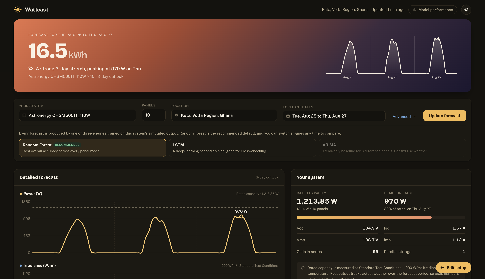

# Wattcast: Solar Output Forecasting Using Time Series and Machine Learning

Predicts how much power a solar panel will actually put out, hour by hour,
using real weather. Not the panel's rated capacity on a spec sheet, what
it'll really produce given tomorrow's actual clouds and temperature. Three
models get compared head to head (Random Forest, LSTM, ARIMA), and the
best of them ends up running a live web dashboard, Wattcast.

This README follows the whole thing in order: where the data actually
comes from, how it gets simulated, how the models get trained and scored,
and how you'd run any of it yourself.

## Setup

Needs Python 3.12, that's what this was built and tested on.

```
python3 -m venv .venv
source .venv/bin/activate          # Windows: .venv\Scripts\activate
pip install -r requirements.txt
```

That's all you need to run the CLI or the web app against the models
already trained here. MATLAB with Simulink only comes into play if you
want to regenerate the panel cache or the simulated training data
yourself, which the rest of this README walks through.

## Where the weather comes from

Every hour of weather behind this project, the historical archive used to
train the models and the live forecast the web app calls, comes from
[Open-Meteo](https://open-meteo.com/), a free, open-source weather API.
No key, no signup, and it's the only reason any of this can react to a
real date instead of just replaying the past.

Two different parts of it get used:

- **Historical archive**, for training: the actual weather that hit one
  fixed site (8.12N, -1.23W) hour by hour for years back, exported as a
  CSV and dropped in as `data/raw/weather_data.csv`. There's no script for
  this part since it's a one-time export from Open-Meteo's historical
  weather archive; you'd request temperature, shortwave radiation,
  relative humidity, cloud cover, wind speed, precipitation, and dew
  point, all hourly, for whatever site and date range you want to train
  against.
- **Live forecast**, for actually using the thing: `common/weather_api.py`
  calls Open-Meteo's forecast API directly, no download needed, covering
  roughly 3 months back through 16 days ahead. This is what the web app
  and the CLI both call at request time.

Before that raw historical export goes anywhere near a simulation,
`scripts/preprocess_weather_data.py` gives it a once-over: missing values,
duplicate timestamps, gaps in the hourly sequence, readings outside a
sane physical range. Better to catch a bad weather file here than after
burning simulation time on it.

## Where the panels come from

The 235 solar panels in this project aren't made up. They're real,
datasheet-backed parts from MATLAB Simscape Electrical's own Solar Cell
library, everything from small ~85W panels to large industrial ones
across 19 manufacturers.

`simulink/generate_panel_cache.m` walks that entire part library and
pulls out what each one actually is: its rated voltage, current, power,
series/parallel cell counts, temperature and irradiance response curves,
IV curve. All of it goes into `data/raw/panel_cache.db`, and everything
downstream (the simulation, every model, the web app's panel picker)
reads from this one database rather than re-deriving specs from anywhere
else.

This has to run before the simulation below; the simulation gets its list
of panels to simulate straight out of this database. It's already
committed to this repo, so you'd only rerun it if you deleted it or the
part library changed.

## Running the simulation

This is the actual core of the project: for every one of those 235
panels, simulate what it would have produced, hour by hour, under the
real historical weather from above. Not a formula, an actual Simscape
Electrical circuit, the solar cell's own electrical model reacting to
irradiance and temperature the same way the physical panel would.


Irradiance and temperature go in on the left, the panel's real electrical
behavior determines current and voltage, and power comes out on the
right, exactly what a physical installation's inverter would actually
measure. `simulink/generate_training_data_all_panels.m` runs this circuit
once per panel against the full historical weather record, writing every
hour of every panel's simulated output to
`data/simulated/training_data_all_panels.csv`. That file gets big
(several GB) since it's 235 panels times years of hourly data.

`scripts/finalize_training_data.py` then takes that CSV and turns it into
something the training scripts can actually work with: a Parquet file
(`data/processed/training_data.parquet`), streamed through DuckDB so the
~5.8GB CSV never has to load into memory all at once. It also pulls out 3
representative panels (small/medium/large) into their own file for ARIMA,
which trains one model per panel rather than one model for everything.

## Training three different models

Same training data, three genuinely different approaches, on purpose:

```
python training/train_random_forest.py
python training/train_lstm.py
python training/train_arima.py           # add --force to refit even if a saved model exists
```

**Random Forest** and **LSTM** both train on all 235 panels at once,
weather plus panel specs in, power out, so either one can generalize to a
panel it never even saw during training. **ARIMA** is the odd one out: it
never sees weather at all, it only extrapolates a single panel's own past
output forward in time, and it has to be fit separately per panel since
it has no way to generalize across them. It's kept in the comparison
specifically as the weather-blind baseline, to show what you actually
gain by giving a model real weather instead of just its own history.

## How they actually stack up


Real numbers from the last training run (`output/tables/`):

| Model | MAE (W) | RMSE (W) | MAPE (%) | R2 |
|---|---|---|---|---|
| Random Forest | 0.11 | 0.27 | 0.72 | 0.99999 |
| LSTM | 1.33 | 2.11 | 5.85 | 0.99960 |
| ARIMA (avg across 3 panels) | 69.31 | 78.96 | 54.64 | 0.17663 |

R2 is shown to 5 decimal places on purpose. Random Forest's real number
(0.9999935870843596) isn't actually 1.0, and rounding it any less would
make it look like a perfect fit when it's not.

ARIMA trails by a mile, exactly as expected for a model with no weather
input trying to forecast a weather-driven quantity. Random Forest and
LSTM, both actually seeing tomorrow's weather, get dramatically closer.
That gap is the entire argument for why weather-aware forecasting is
worth building. Random Forest also being the strongest of the three (and
the cheapest to run) is why it's the one wired into the web app below,
ARIMA never made the cut.

## Using it: the command line

```
python forecast_cli.py                                            # interactive prompt
python forecast_cli.py --panel AS_6M30_HC_320W --date 2026-08-20 --model random_forest --quantity 12
python forecast_cli.py --list-panels --search amerisolar
python forecast_cli.py --help
```

Prints an hourly forecast straight to the terminal and saves a plot
(power, irradiance, temperature) to `output/figures/`.

## Using it: the web app

```
python backend/app.py
```

Then open `http://127.0.0.1:5000`. This is the actual point of all the
above: pick a panel, how many you own, and a location, and get a real
forecast back, not a demo number.



Location can come from real GPS through the browser or just searching a
city, both backed by free geocoding, no key needed either. Every forecast
here is Random Forest, live Open-Meteo weather, run for real against
whatever panel and dates you picked, and it also prints the full hourly
prediction to the server console so you can show the raw model output
next to the dashboard instead of just trusting the UI. Runs on Flask's
debug server, fine for local use or a demo, not meant for production as-is.

## Regenerating any of it yourself

Only needed if `data/raw/panel_cache.db`, `data/processed/`, or
`data/simulated/` are missing, everything above is already committed and
trained. In order:

1. `scripts/preprocess_weather_data.py` to sanity-check the raw weather
   export first (see "Where the weather comes from"). Not a hard
   dependency of the steps below, just worth doing before spending
   simulation time on a bad weather file.
2. `simulink/generate_panel_cache.m` (see "Where the panels come from")
3. `simulink/generate_training_data_all_panels.m`, which needs step 2's
   database to already exist (see "Running the simulation")
4. `scripts/finalize_training_data.py`, which needs step 3's simulation
   output to already exist (see "Running the simulation")
5. Whichever `training/train_*.py` script you need (see "Training three
   different models")

Needs MATLAB R2025a or R2025b for the Simulink steps:
`PVOutputSimulation2025a.slx` is for R2025a, `PVOutputSimulation.slx` is
for R2025b. The `.m` scripts load the 2025a one by default, so on R2025b
you'll need to point them at the other file instead. Got a different
MATLAB version? Email hello@asare.me and I'll sort you out a compatible
model file.

## What's not in this repo

Three things, all regenerable from what IS committed here, left out via
`.gitignore` since together they're around 30GB:

- `data/processed/` and `data/simulated/`, about 6GB of generated
  training data.
- `models/`, about 23GB of trained weights. Random Forest alone is around
  17GB once trained (200 trees, full depth, 22M+ rows), so loading it
  cold takes 15-20 seconds even after training's already done. That's
  expected, not a bug.

`data/raw/` (under 6MB: the panel spec database and the historical
weather export) IS committed though, since it's tiny and you need it to
run anything at all without regenerating stuff from MATLAB first.

## Project layout

```
backend/            Flask web app + Wattcast dashboard (templates/static)
common/             Shared inference, dataset, and feature-engineering code
evaluation/         Shared metrics (MAE/RMSE/MAPE/R2) used by every training script
forecast_cli.py     Command-line forecast tool
scripts/            Data preprocessing (weather cleaning, final training table)
simulink/           MATLAB/Simulink panel simulation models
training/           One training script per model (random_forest, lstm, arima)
output/              Evaluation results (tables/) and saved forecast plots (figures/)
data/raw/           Small committed seed data (panel specs, historical weather)
data/processed/     Generated training data (gitignored)
data/simulated/     Raw Simulink simulation output (gitignored)
models/             Trained model weights (gitignored)
```
