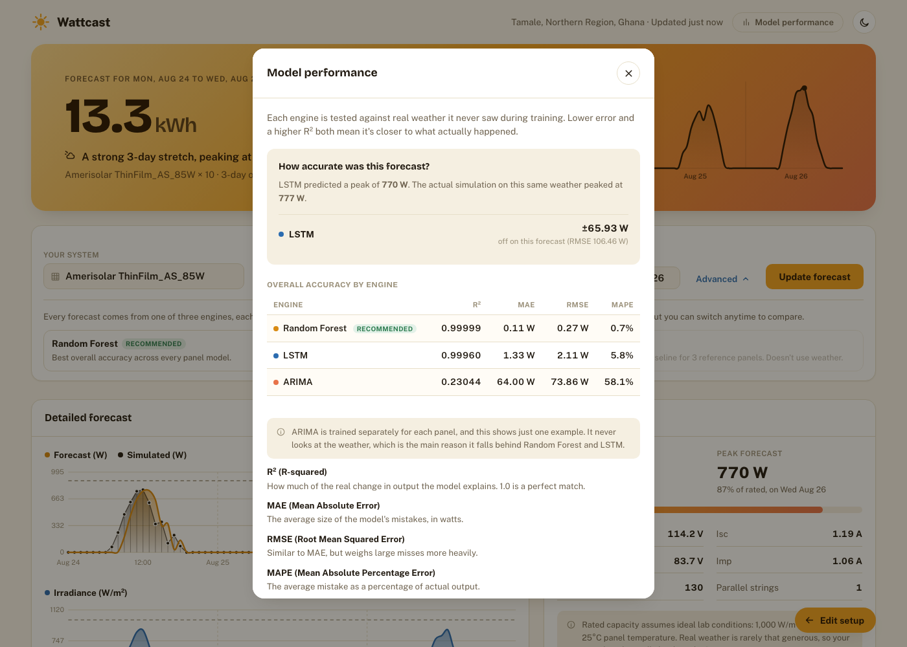
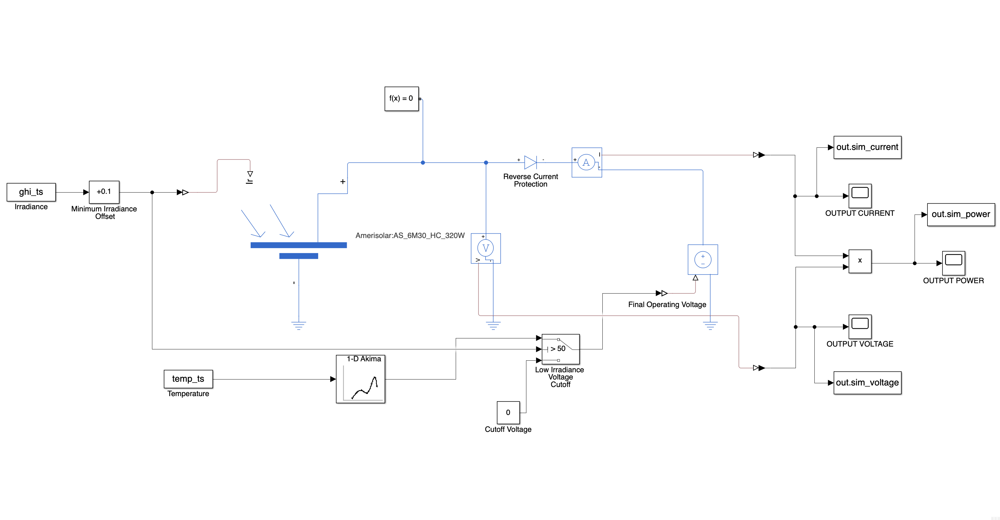

# Wattcast: Solar Output Forecasting Using Time Series and Machine Learning

Forecasts hourly solar panel output using live weather and one of three
models, Random Forest, LSTM, or ARIMA. Comes with a CLI, a web dashboard
(Wattcast), and the whole pipeline behind it: Simulink panel simulation,
data prep, model training, and evaluation.

## Screenshots

**Forecast dashboard**: pick a panel, quantity, location, and date range,
get an hourly forecast backed by live weather.


**Model performance**: real evaluation numbers for all three engines, and
what each one's typical error actually means for your current forecast.



**Simulink model**: the actual circuit behind every panel's simulated
output. Irradiance and temperature go in, current/voltage/power comes out.



## How it fits together

```
Simulink panel simulation (simulink/)
    -> raw simulated power data (data/simulated/, gitignored)
    -> preprocessing (scripts/)
    -> training data (data/processed/, gitignored)
    -> model training (training/)
    -> trained models (models/, gitignored)
    -> shared inference layer (common/inference.py)
    -> forecast_cli.py  and  backend/ (the Wattcast web app)
```

`common/` is the only place either the CLI or the web app actually calls to
get a forecast. Neither one duplicates any forecasting logic, they're both
just thin wrappers turning a terminal argument or an HTTP request into a
call to `common/inference.py`.

## What's NOT in this repository

Three things are left out on purpose (see `.gitignore`), all regenerable
from what IS committed here:

- `data/processed/` and `data/simulated/`, about 6GB of pipeline-generated
  training data. Regenerate it via `simulink/` and `scripts/` below.
- `models/`, about 23GB of trained weights. Regenerate via `training/`
  below. Random Forest alone is around 17GB once trained (200 trees, full
  depth, 22M+ rows), so loading it cold takes 15-20 seconds even after
  training's already done. That's expected, not a bug.

`data/raw/` (under 6MB: the panel spec database and the historical weather
export) IS committed though, since it's tiny and you need it to run
anything at all without regenerating stuff from MATLAB first.

## Setup

Needs Python 3.12, that's what this was built and tested on.

```
python3 -m venv .venv
source .venv/bin/activate          # Windows: .venv\Scripts\activate
pip install -r requirements.txt
```

You only need MATLAB with Simulink if you want to regenerate the panel
cache or the simulated training data yourself. Running the CLI or the web
app off already-trained models doesn't need anything beyond the Python
setup above. Needs MATLAB R2025a or R2025b: `PVOutputSimulation2025a.slx`
is for R2025a, `PVOutputSimulation.slx` is for R2025b. The `.m` scripts
load the 2025a one by default, so on R2025b you'll need to point them at
the other file instead. Got a different MATLAB version? Email
hello@asare.me and I'll sort you out a compatible model file.

## Reproducing the data pipeline

Only needed if `data/raw/panel_cache.db`, `data/processed/`, or
`data/simulated/` are missing. Run these in order, each one depends on the
last:

1. `simulink/generate_panel_cache.m` goes through every Solar Cell part in
   the Simscape Electrical collection and pulls its specs (temperature/
   irradiance curves, IV curve, rated values) into
   `data/raw/panel_cache.db`. This one has to go first: step 2 reads the
   panel list straight from this database, not from the Simulink
   collection itself. It's already committed here, so you only need to run
   this again if you've deleted it or the part collection's changed.
2. `simulink/generate_training_data_all_panels.m` reads the panel list from
   `panel_cache.db`, loads `PVOutputSimulation2025a.slx`, and simulates
   every panel's hourly output against the historical weather
   (`data/raw/weather_data.csv`). Writes out
   `data/simulated/training_data_all_panels.csv`, which is big, several GB.
3. `scripts/preprocess_weather_data.py` cleans up the raw Open-Meteo
   weather export and checks it for missing values, duplicate timestamps,
   gaps in the hourly sequence, and readings that are just out of range.
4. `scripts/finalize_training_data.py` merges the simulated power data, the
   cleaned weather, and the panel specs into one final training table.
   This is what every model actually trains on.

## Training the models

Each script runs on its own and writes its own results:

```
python training/train_random_forest.py
python training/train_lstm.py
python training/train_arima.py           # add --force to refit even if a saved model exists
```

All three read from `data/processed/` and write to `models/`, plus a
results CSV in `output/tables/`. Random Forest and LSTM train on all 235
panels at once. ARIMA fits a separate model per representative panel
(small/medium/large) since it can't generalize across panels at all.

Real evaluation results from the last training run (see `output/tables/`):

| Model | MAE (W) | RMSE (W) | MAPE (%) | R2 |
|---|---|---|---|---|
| Random Forest | 0.11 | 0.27 | 0.72 | 0.99999 |
| LSTM | 1.33 | 2.11 | 5.85 | 0.99960 |
| ARIMA (avg across 3 panels) | 69.31 | 78.96 | 54.64 | 0.17663 |

R2 is shown to 5 decimal places on purpose. Random Forest's real number
(0.9999935870843596) isn't actually 1.0, and rounding it any less would
make it look like a perfect fit when it's not.

ARIMA trails the other two by a lot because it never sees weather at all,
it just extrapolates a panel's own past output forward in time. It's still
in the comparison to show how much you actually gain from a weather-aware
model over a plain historical one. It's also the only one of the three not
wired into the web app, same reason.

## Running the command-line tool

```
python forecast_cli.py                                            # interactive prompt
python forecast_cli.py --panel AS_6M30_HC_320W --date 2026-08-20 --model random_forest --quantity 12
python forecast_cli.py --list-panels --search amerisolar
python forecast_cli.py --help
```

Prints an hourly forecast straight to the terminal and saves a plot
(power, irradiance, temperature) to `output/figures/`.

## Running the web app

```
python backend/app.py
```

Then open `http://127.0.0.1:5000`. The setup wizard walks you through
picking a panel, quantity, and location, real GPS through the browser or
just search a city, both use free geocoding APIs, no key needed. Then you
get the forecast dashboard with live Open-Meteo weather behind it. It runs
on Flask's debug server, which is fine for local use or a demo, just don't
put this in production as-is.

Every forecast also prints the full hourly prediction to the server
console, so you can show the raw model output side by side with the
dashboard instead of just trusting the UI.

## Project layout

```
backend/            Flask web app + Wattcast dashboard (templates/static)
common/             Shared inference, dataset, and feature-engineering code
evaluation/         Shared metrics (MAE/RMSE/MAPE/R2) used by every training script
forecast_cli.py     Command-line forecast tool
scripts/            Data preprocessing (weather cleaning, final training table)
simulink/           MATLAB/Simulink panel simulation models
training/           One training script per model (random_forest, lstm, arima)
output/              Evaluation results (tables/) and saved forecast plots (figures/)
data/raw/           Small committed seed data (panel specs, historical weather)
data/processed/     Generated training data (gitignored, see "Reproducing the data pipeline")
data/simulated/     Raw Simulink simulation output (gitignored)
models/             Trained model weights (gitignored, see "Training the models")
```
